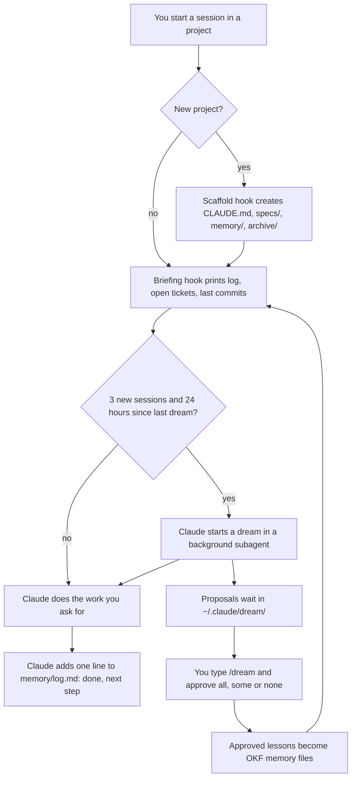

# claude-profile

A Claude Code profile that makes Claude work the same way in every project and on every machine, and lets it pick up where the last session stopped.

It solves three problems:

- **Notes go stale.** Claude cannot tell an outdated plan or TODO from a current one, so it follows the wrong one.
- **Every session starts cold.** A new session knows nothing about what the last one did.
- **Lessons are lost.** You correct Claude in one session and have to correct it again in the next.

## Contents

- [What you get](#what-you-get)
- [How it works](#how-it-works)
- [Use cases, with examples](#use-cases-with-examples)
- [What a project looks like](#what-a-project-looks-like)
- [Set up a machine](#set-up-a-machine)
- [Day-to-day commands](#day-to-day-commands)
- [What else is possible](#what-else-is-possible)
- [What is verified, and what is not](#what-is-verified-and-what-is-not)
- [Files in this repository](#files-in-this-repository)
- [Change the profile](#change-the-profile)
- [Where the ideas come from](#where-the-ideas-come-from)

## What you get

| Part | What it does | When it runs |
| --- | --- | --- |
| Global rules (`CLAUDE.md`) | Tells Claude which source to trust, how to treat plans and tickets, how to write memories, and how to use subagents. | Every session, every project |
| Project scaffold | Creates `CLAUDE.md`, `specs/`, `memory/` and `archive/` in a new project root. | Automatically, when a session starts in a new project |
| Session briefing | Gives Claude the latest log entries, tickets in progress and recent commits. | Automatically, at the start of every session |
| Memory in Open Knowledge Format (OKF) | Every memory records where it came from, who confirmed it, its status and when to check it again. | Whenever Claude saves a memory |
| `/dream` | Reviews past sessions in the background and proposes memory changes, with the sessions as evidence. | Automatically after 3 new sessions and 24 hours; you approve with `/dream` |
| `/sweep` | Finds outdated TODOs, plans, rules and memories, proves each against the code, and proposes what to archive, update or cut. | When you type `/sweep` |

Nothing that changes your memory, plans or rules happens without your yes. The automatic parts only create missing files, read, and propose.

## How it works



### The rules

The global `CLAUDE.md` loads in every session. The main rules are:

- **The app wins over notes.** "The app" is the code, how it behaves when run, and the git history. If a note or plan disagrees with it, Claude follows the app and tells you about the mismatch. The one exception is a plan marked "in progress": that describes where the app is going, so Claude follows the plan.
- **Hands off what was not asked about.** Claude leaves other notes, TODOs and plans alone and lists the relevant ones at the end of its reply.
- **Check before building.** For a feature request that is not a numbered ticket, Claude compares it with `specs/prd.md` and the tickets first, flags overlap or conflict, and asks before building.
- **Ticket status.** Every ticket carries `Status: not started`, `Status: in progress` or `Status: done`, checked against the app.

### The scaffold

A session-start hook runs `project-scaffold.mjs`. In a project root that has no `CLAUDE.md` or `AGENTS.md` yet, it creates the four parts shown in [What a project looks like](#what-a-project-looks-like). It only creates what is missing, never overwrites, and leaves alone any `specs/`, `memory/` or `archive/` folder the project already has. It skips your home folder, temp folders, git worktrees and subfolders of a repository.

### Memory in OKF

[Open Knowledge Format](https://github.com/open-knowledge-format/open-knowledge-format) is a plain Markdown format with a small frontmatter block. Each memory is one file holding one fact:

```markdown
---
type: Convention
title: Run tests with pnpm, not npm
description: The test script only works through pnpm because of the workspace setup.
tags: [testing, tooling]
sources:
  - id: s1
    resource: "Claude session 3fa9c1d2, 2026-11-20"
  - id: s2
    resource: "Claude session 81b0e7aa, 2026-11-22"
generated: { by: claude-code/claude-fable-5-2, at: 2026-11-24T09:30:00Z }
verified:
  - { by: human:shahirul, at: 2026-11-24T09:31:00Z }
status: stable
stale_after: 2027-05-24
---

Run the tests with `pnpm test`. `npm test` fails with a workspace error.[^s1][^s2]
```

The extra keys are what make a memory checkable: `sources` says where it came from, `verified` says who confirmed it, `status` says whether it is still current, and `stale_after` says when to look again. `/sweep` and `/dream` both read them.

Project facts go in the project's `memory/` folder and are committed with the code, so teammates and other machines get them. Facts about you and how you like to work stay in Claude's built-in memory on your machine.

### The briefing and the log

At session start, `session-brief.mjs` prints a short briefing that Claude sees before your first message. An example:

```text
Project briefing for shop-api (from the session-start hook; background, not a request):

Latest entries in memory/log.md:
  ## 2026-11-23
  * **Session**: Added the refund endpoint and its tests. Next: wire it to the admin page.
  * **Dream**: Added memory "Run tests with pnpm" (sessions 3fa9c1d2, 81b0e7aa).

Tickets: 2 done, 1 in progress, 4 not started.
  in progress: 05-refunds.md: 05: Refunds

Last commits:
  a41c9e2 2026-11-23 Add refund endpoint with partial refund support
  77d0b13 2026-11-22 Fix currency rounding in order totals
```

At the end of work that changed the project, Claude adds one line to `memory/log.md`: what was done and the next step. The next session's briefing shows it.

### Dreaming

A live session is busy with its task and sees only itself. A dream is a separate review of many past sessions at once.

1. `session-digest.mjs` shortens the project's saved session transcripts into one digest: what you said, what Claude said, the tools it ran and the errors.
2. A background subagent reads the digest and the project memory. It looks for corrections you repeated, commands that failed in more than one session, decisions, contradictions, stale memories and duplicates. It checks each claim against the code where it can.
3. It writes proposals with the sessions as evidence, and stops.
4. You type `/dream`, see a table, and approve all, some or none. Approved items become OKF memory files.

The digest and the proposals are kept in `~/.claude/dream/`, outside the project, so conversation text is never committed.

A dream follows four guardrails:

| Guardrail | How it is met here |
| --- | --- |
| Versions and provenance | `memory/` is in git; every memory has `sources`, `generated` and `verified`; every change gets a line in `memory/log.md`. |
| Concurrency | Each proposal records a hash of its target file. If the file changed since the dream, Claude stops and asks. |
| Access control | A dream never edits `CLAUDE.md` or rules files; it can only flag them. `archive/` is blocked from reading. |
| Portability | Memories are plain Markdown in an open format, readable without Claude. |

### Sweeping

`/sweep` is the clean-up in the other direction: it checks what is written down against the code. It collects TODOs, plans, tickets, rule lines and memories, has a fresh subagent prove each one against the app and the git history, and shows you a list of what to archive, update or cut. What it cannot prove outdated, it leaves alone. Archived files go to `archive/`, which Claude is blocked from reading, so they cannot mislead it again.

## Use cases, with examples

The conversations below are illustrations of the intended behaviour, not recordings.

### 1. Picking up yesterday's work

You open the project the next morning and type one line.

> **You:** continue
>
> **Claude:** Yesterday's session added the refund endpoint and its tests; the open step is wiring it to the admin page, which is ticket 05 (in progress). I'll start there.

Without the briefing, Claude would ask what you were working on.

### 2. A plan that no longer matches the code

`specs/prd.md` says sessions are stored in Redis. The code moved to Postgres two weeks ago.

> **You:** add a "log out everywhere" button
>
> **Claude:** Done: the button deletes every row for the user in the `sessions` table. One mismatch to know about: `specs/prd.md` still says sessions live in Redis, but the code has used Postgres since commit `c2e91f0`. I followed the code and did not change the PRD.

### 3. A feature that overlaps an existing ticket

> **You:** add CSV export for orders
>
> **Claude:** Before I build this: ticket `07-reports.md` (not started) already covers "export orders as CSV or Excel". Do you want me to do it as part of ticket 07, or as a separate, smaller feature?

### 4. A lesson learned across sessions

In three sessions, Claude ran `npm test`, it failed, and you said "use pnpm". The next session starts with:

> **Claude:** A dream over your last 4 sessions is running in the background; it will only propose.

Later:

> **You:** /dream
>
> **Claude:**
>
> | # | Action | What | Evidence | Checked |
> | --- | --- | --- | --- | --- |
> | 1 | add | Run tests with `pnpm test`, not `npm test` | 3 of 4 sessions; you corrected it each time | `package.json` has a pnpm workspace |
> | 2 | deprecate | Memory "staging is on port 8080" | 2 sessions used 8090 | `docker-compose.yml` maps 8090 |
>
> Which numbers should I apply: all, some or none?

After your yes, Claude stops making that mistake in this project.

### 5. Cleaning up before a release

> **You:** /sweep
>
> **Claude:**
>
> | # | Action | Item | Where | Why |
> | --- | --- | --- | --- | --- |
> | 1 | Cut | `TODO: add rate limiting` | `src/api/server.ts:42` | Rate limiting was added in commit `9be01aa` |
> | 2 | Update | Ticket 03 says `Status: in progress` | `specs/tickets/03-login.md` | All four "done when" points are built and tested |
> | 3 | Archive | `specs/old-auth-plan.md` | `specs/` | Replaced by ticket 03; commit `4d1e7c2` says so |
>
> Could not prove, left alone: 2 items. Which numbers should I apply?

### 6. A new machine or a new teammate

Paste one prompt (see [Set up a machine](#set-up-a-machine)) and the machine has the same rules, hooks and skills. Because project memories live in the project's `memory/` folder, a `git pull` brings the project's lessons too.

## What a project looks like

After the scaffold has run:

```text
my-project/
├── CLAUDE.md               the project rules (the app wins, tickets, memory, archive)
├── specs/
│   ├── prd.md              what the app must do
│   └── tickets/
│       ├── README.md       ticket naming and the status line
│       └── 01-login.md     one file per ticket: "Status: in progress"
├── memory/                 project memory, in OKF, committed with the code
│   ├── index.md            the list of memories
│   ├── log.md              what changed and what each session did, newest day first
│   ├── README.md           the template for a memory file
│   └── use-pnpm.md         one fact per file
├── archive/                outdated material; Claude is blocked from reading it
│   └── INDEX.md
└── .claude/
    └── settings.json       the rule that blocks archive/
```

## Set up a machine

Needs Claude Code and Node.js. No clone is needed.

1. Open [SETUP-PROMPT.md](SETUP-PROMPT.md) and copy the whole file. It holds the complete profile: the rules, three scripts, two skills and the hooks.
2. Paste it into Claude Code on that machine. Claude merges the rules with what is already there, backs up any file before replacing it, adds the hooks with that machine's own home path, and tests the result.
3. Start a new session.

Paste the latest version of the same prompt again to update a machine.

## Day-to-day commands

| You want to | Do this |
| --- | --- |
| See and approve what Claude learned from past sessions | Type `/dream` |
| Clean out outdated notes, plans and memories | Type `/sweep` |
| Set up a project that already has `CLAUDE.md` or `AGENTS.md` | `node ~/.claude/scripts/project-scaffold.mjs --update-claude-md <folder>` |
| Keep a project out of the automatic setup | Create an empty `.claude/no-scaffold` file in it |
| Dream more or less often | Set the environment variables `DREAM_MIN_SESSIONS` (default 3) and `DREAM_MIN_HOURS` (default 24) |
| Run a dream now | Type `/dream` when no proposals are waiting |

## What else is possible

None of these is built. They are directions this setup makes straightforward.

- **Overnight dreaming.** Run the dream on a schedule instead of at session start, so proposals are ready in the morning. This is the "learning while you sleep" idea in full.
- **Team memory.** Because `memory/` is committed, a team shares one set of project lessons, and a pull request is the review step for a memory change.
- **Dreaming across projects.** Review sessions from all projects together to find habits that belong in the global `CLAUDE.md`, not in one project.
- **Unattended work.** A scheduled session could read the briefing, take the next "not started" ticket, work on a branch and open a pull request. The briefing, ticket statuses and log are the pieces such a loop needs; the loop itself is not here.
- **A memory check in CI.** OKF files can be linted, so a pipeline could fail when a memory is past its `stale_after` date or has no source.
- **Reading the memory elsewhere.** OKF is plain Markdown, so the same `memory/` folder opens in Obsidian or any other tool that reads it.
- **Promoting lessons to skills.** When a dream finds the same multi-step procedure repeated, propose a skill for it instead of a memory.

## What is verified, and what is not

Tested on 2026-11-24, on one Windows 11 machine, with Claude Code 2.1.330 and Node.js 24.

### Verified

| # | Claim | How it was tested | Result |
| --- | --- | --- | --- |
| 1 | The scaffold hook fires when a real session starts in a new folder. | Started a real Claude Code session in an empty folder. | Pass. All 8 files were created. |
| 2 | The briefing hook fires, and Claude Code records its text as session-start hook output. | Started a second real session in that folder and read the hook events. | Pass. Both hooks ran with exit code 0 and the briefing text was in the hook output. |
| 3 | The setup prompt installs the profile. | A fresh agent followed `SETUP-PROMPT.md` against two simulated config folders: one empty, one with its own `CLAUDE.md` and `settings.json`. | Pass. All checks in the prompt passed. The installed files were identical to the source. Existing settings and an existing hook survived, and both changed files were backed up first. |
| 4 | A full dream works: digest, proposals, approval, memory files. | A test project with 3 made-up past sessions containing 2 planted lessons, 1 planted instruction aimed at an AI reader, and 1 piece of one-off task state. | Pass. It proposed exactly the 2 lessons (seen in 3 of 3 and 2 of 3 sessions), checked both against the project files, ignored the planted instruction and the task state, and on approval wrote valid OKF files, updated the index and log, and removed the pending file. |
| 5 | The briefing reports waiting proposals, then stops once they are handled. | Ran the briefing after each phase of test 4. | Pass. |
| 6 | A full sweep works: collect, prove, list, apply. | A test project with 8 planted items: some outdated, some current, some unprovable. | 7 of 8 correct. It cut the finished TODO, left the unprovable TODO, left the in-progress ticket, archived the replaced plan and the dead memory, and fixed the wrong command in `CLAUDE.md`. The miss: it marked a ticket done when its "Done when" points were met but its goal was only partly met. The rule is now stricter (see "Changed after testing"). |
| 7 | The digest keeps what the user said. | Measured on 3 real projects with 5, 29 and 30 saved sessions. | Pass, after a fix. Every user message (39 of 39, 189 of 189, 167 of 167) and every tool error is kept. Before the fix, one project kept only 60 of 189. |
| 8 | Sessions run in a project's Claude worktrees are included in a dream. | Counted sessions for 3 real projects. | Pass, after a fix. One project went from 26 to 30 sessions, another from 0 to 3. |

### Measured

- **A dream cost about 84,000 tokens and 83 seconds** on Sonnet, for the 3 short test sessions. The digest of a large real project is about 120,000 characters, so a real dream will cost more. That was not measured.
- **A sweep cost about 89,000 tokens and 113 seconds** on Sonnet, for the small test project.
- **The digest holds the 20 most recent sessions.** In the two large projects, 9 and 10 older sessions were left out of a first dream. After the first dream, each dream covers only the sessions since the last one, so this applies to the first run on a project with a long history.

### Not verified

| # | What | Why not | How to check |
| --- | --- | --- | --- |
| 1 | Claude acts on the briefing in a live session: it uses the log to continue work, starts a dream when one is due, and tells you when proposals wait. | The command-line login on the test machine had expired, so no model reply could be captured. Tests 1 and 2 show the hooks deliver the text; they do not show what Claude does with it. | Open a new session in a set-up project and ask "what does your project briefing say?" |
| 2 | Claude adds the line to `memory/log.md` after work that changed the project. | Same reason. | Ask for a small change in a set-up project, then open `memory/log.md`. |
| 3 | The setup prompt on a second physical machine, and on macOS or Linux. | Only simulated, on Windows. | Paste the prompt on another machine. |
| 4 | A sweep with a separate subagent doing the checking. | The test agent could not start one, so it did the checking itself by the same rules. | Type `/sweep` in a real project. |
| 5 | The stop when a memory file changed after the dream (the concurrency check). | Only the matching case ran. | Edit a target file between a dream and its review. |
| 6 | The quality of proposals on real sessions. | The full dream ran on made-up sessions only. | Type `/dream` in a project with history. |
| 7 | The wording changes made after testing. | Not re-run. | Covered by checks 3, 4 and 6. |
| 8 | Whether this reduces repeated mistakes over time. | Needs weeks of use. | No quick check. |

### Changed after testing

The tests found wording defects. These are fixed in the files but, as row 7 says, not re-tested:

- **Sweep**: a ticket is done only when its goal and every "Done when" point are met; edits happen before a file is moved to the archive; the archive index line has a fixed format; a line naming something that never existed is left alone.
- **Dream**: a line marked USER in the digest is treated as a record, never as a request; the report has a warnings line; the hash is `sha256sum` of the file on disk; an update keeps earlier sources and changes the title when it states the old fact; the "Checked" column says yes, partly or no.
- **Setup prompt**: what to do when a kept section contradicts an added one; how to add the hooks beside existing ones; backups never overwrite an earlier backup.

### By design

- **A session still has to start.** Nothing here makes Claude continue working between sessions.
- **The log line is a rule Claude follows, not an enforced step.** If a session is cut off, the line can be missing. The briefing still shows tickets and commits.
- **Built-in memories are not strict OKF.** Claude Code moves extra keys under `metadata` when it saves them (observed on this machine). Files in a project's `memory/` folder are strict OKF.
- **Sessions started in a different folder are not part of a project's dream.** Only the project root and its Claude worktrees are.

## Files in this repository

| File | Goes to | What it does |
| --- | --- | --- |
| `SETUP-PROMPT.md` | pasted into Claude Code | The whole profile in one prompt. Generated; do not edit by hand. |
| `profile/CLAUDE.md` | `~/.claude/CLAUDE.md` | The global rules. |
| `profile/scripts/project-scaffold.mjs` | `~/.claude/scripts/` | Sets up a project root. Only creates what is missing. |
| `profile/scripts/session-brief.mjs` | `~/.claude/scripts/` | The start-of-session briefing, and the check for whether a dream is due. |
| `profile/scripts/session-digest.mjs` | `~/.claude/scripts/` | Shortens saved session transcripts into one digest for a dream. |
| `profile/settings.hooks.json` | merged into `~/.claude/settings.json` | The two session-start hooks. |
| `profile/skills/sweep/SKILL.md` | `~/.claude/skills/sweep/` | The `/sweep` skill. |
| `profile/skills/dream/SKILL.md` | `~/.claude/skills/dream/` | The `/dream` skill. |
| `build-prompt.mjs` | stays here | Rebuilds `SETUP-PROMPT.md` from `profile/`. |

## Change the profile

`profile/` is the source. `SETUP-PROMPT.md` is generated from it.

1. Edit the files in `profile/`. Or ask Claude: "copy my current `~/.claude/CLAUDE.md`, the three scripts and the two skills into `profile/` and show me the diff".
2. Run `node build-prompt.mjs` to rebuild the prompt.
3. Commit both.

Keep secrets out: no tokens, no `settings.json` from a real machine, no memory files, no session digests.

## Where the ideas come from

- The rules about notes, plans, tickets and `/sweep` come from a set of Claude Code prompts for keeping outdated material from misleading the model.
- The memory format is the [Open Knowledge Format](https://github.com/open-knowledge-format/open-knowledge-format), version 0.3.
- Dreaming and its four guardrails follow the talk [Learning while you sleep: Beyond memory to dreaming](https://www.youtube.com/watch?v=tTcxVv8HHNw) by Lamis Mukta (Anthropic), AI Native DevCon London, June 2026. This implementation is based on written summaries of the talk, not its transcript.
- The log, the ticket statuses and reading git history at session start follow Anthropic's article [Effective harnesses for long-running agents](https://anthropic.com/engineering/effective-harnesses-for-long-running-agents).
