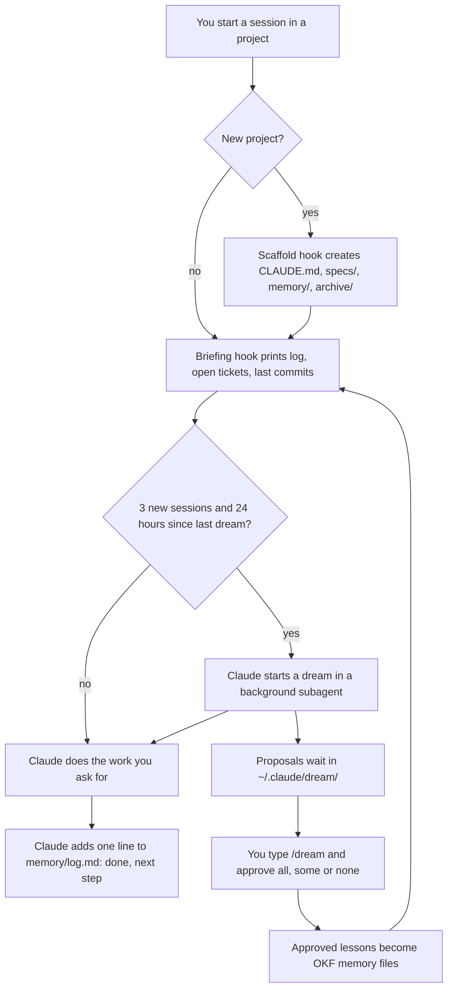

# claude-profile

A Claude Code profile that makes Claude work the same way in every project and on every machine, and lets it pick up where the last session stopped.

It solves three problems:

- **Notes go stale.** Claude cannot tell an outdated plan or TODO from a current one, so it follows the wrong one.
- **Every session starts cold.** A new session knows nothing about what the last one did.
- **Lessons are lost.** You correct Claude in one session and have to correct it again in the next.

## Contents

- [What you get](#what-you-get)
- [How it works](#how-it-works)
- [Use cases, with examples](#use-cases-with-examples)
- [What a project looks like](#what-a-project-looks-like)
- [Set up a machine](#set-up-a-machine)
- [Day-to-day commands](#day-to-day-commands)
- [What else is possible](#what-else-is-possible)
- [What is verified, and what is not](#what-is-verified-and-what-is-not)
- [Files in this repository](#files-in-this-repository)
- [Change the profile](#change-the-profile)
- [Change log](#change-log)
- [Where the ideas come from](#where-the-ideas-come-from)

## What you get

| Part | What it does | When it runs |
| --- | --- | --- |
| Global rules (`CLAUDE.md`) | Tells Claude which source to trust, how to treat plans and tickets, how to write memories, and how to use subagents. | Every session, every project |
| Project scaffold | Creates `CLAUDE.md`, `specs/`, `memory/` and `archive/` in a new project root. | Automatically, when a session starts in a new project |
| Session briefing | Gives Claude the latest log entries, tickets in progress and recent commits. | Automatically, at the start of every session |
| Model check for workers | Blocks a subagent call that names no model, so workers do not quietly run on the session's most expensive model. | Automatically, before every subagent call |
| Context check | Adds a note for Claude when the conversation has grown large, or is picked up again after a break, so it suggests a new session at the next approval point. | Automatically, each time you send a message |
| Lean worker types | Three subagent types, `reader`, `builder` and `reviewer`, that carry only the tools they need, so each starts with far less context than a general-purpose one. | Whenever Claude starts a subagent of that type |
| Memory in Open Knowledge Format (OKF) | Every memory records where it came from, who confirmed it, its status and when to check it again. | Whenever Claude saves a memory |
| `/dream` | Reviews past sessions in the background and proposes memory changes, with the sessions as evidence. | Automatically after 3 new sessions and 24 hours; you approve with `/dream` |
| `/sweep` | Finds outdated TODOs, plans, rules and memories, proves each against the code, and proposes what to archive, update or cut. | When you type `/sweep` |

Nothing that changes your memory, plans or rules happens without your yes. The automatic parts only create missing files, read, and propose.

## How it works



### The rules

The global `CLAUDE.md` loads in every session. The main rules are:

- **The app wins over notes.** "The app" is the code, how it behaves when run, and the git history. If a note or plan disagrees with it, Claude follows the app and tells you about the mismatch. The one exception is a plan marked "in progress": that describes where the app is going, so Claude follows the plan.
- **Hands off what was not asked about.** Claude leaves other notes, TODOs and plans alone and lists the relevant ones at the end of its reply.
- **Check before building.** For a feature request that is not a numbered ticket, Claude compares it with `specs/prd.md` and the tickets first, flags overlap or conflict, and asks before building.
- **Ticket status.** Every ticket carries `Status: not started`, `Status: in progress` or `Status: done`, checked against the app.
- **Workers get a named model.** Claude plans the work itself and gives tasks that can run side by side to subagents: sonnet for simple tasks, opus for harder ones, haiku for file search and logs. Every subagent call names its model.
- **The leanest worker that can do the job.** `reader` to find and read files, `reviewer` to check a change or run a read-only command, `builder` to change files. See [Lean workers](#lean-workers).
- **Sessions stay small.** One session per ticket or phase, with subagents doing the heavy reading and the building. See [Keeping the session small](#keeping-the-session-small).

### The model check

A subagent started without a model runs on the session's model, which is usually the most expensive one. Many plugin agents are set up to do exactly that, and an agent that starts its own subagents passes the habit on. So a rule that only says "pick a model by the task" leaks: the calls that name a model follow it, and the ones that name none quietly do not.

A hook runs `require-agent-model.mjs` before each subagent call. If the call names no model, the hook blocks it with a message that points to the rule. Forks are let through, because they always run on the session's model. If the hook itself fails, it lets the call through, so a fault never blocks work.

This came from measuring two real working sessions. Every subagent call that named a model ran on that model. The calls that named none, all to plugin review agents, started 37 subagents on the session's model, and those made up about half of what the two sessions cost. On the model the rule intended, they would have cost about half as much.

### Keeping the session small

Every turn re-reads the whole conversation. A session that keeps growing costs more on every turn, and after a break the whole of it is sent again at full price.

The rules in `CLAUDE.md` aim at three habits:

- **One session per ticket or phase.** A phase ends where Claude already stops for you: an approval point or the end of a request. Once the context check's note has appeared, Claude adds one line there suggesting a new session, with the plan on disk and the log line written. It does not stop anywhere else for this. The briefing then carries the state across.
- **Workers do the heavy reading and the building.** Claude reads the files it is about to edit. A survey of more than about three files, and a build from an approved spec, go to a subagent that reports back conclusions.
- **Nothing is read twice.** A file already in the conversation is not read again unless it changed, and an image is looked at once.

A hook runs `context-check.mjs` each time you send a message. It reads the size of the conversation from the session's transcript and adds one line for Claude in two cases: the conversation is at 250,000 tokens or more, or it is at 150,000 or more and has been idle for over an hour. After a break the note tells Claude to say so straight away, because the cost falls on the very next turn; otherwise it waits for the next approval point. The hook only advises. It cannot start or shorten a session, and it never blocks a message.

This came from measuring one long working session. Its conversation grew from 94,000 to 829,000 tokens with no reset. File reads by the main session made up 27% of that and files it wrote itself 20%. It was also picked up again after a 94-minute break at 453,000 tokens, which sent all of that again at full price.

### Lean workers

Every subagent pays its own starting context: the tools, lists and instructions it is given before it reads a single file. A general-purpose subagent is given everything the main session has.

The profile adds three types that are given only what they need:

| Type | Tools | For |
| --- | --- | --- |
| `reader` | read and search | Finding and reading. It reports conclusions with file and line and cannot change anything. |
| `builder` | read, edit, write, shell, search | A scoped change from a brief or an approved checklist, with its tests. |
| `reviewer` | read, search, shell; no edit or write | Checking a change or a draft with no knowledge of how it was made. |

None of them can use the web or a connector, or start subagents of its own. For that, Claude still uses a general-purpose one.

This came from measuring the subagents started on one machine over five days. A general-purpose subagent started at about 66,000 tokens (52 runs). Subagents defined with a short tool list started at 5,000 to 11,000 (about 160 runs).

### The scaffold

A session-start hook runs `project-scaffold.mjs`. In a project root that has no `CLAUDE.md` or `AGENTS.md` yet, it creates the four parts shown in [What a project looks like](#what-a-project-looks-like). It only creates what is missing, never overwrites, and leaves alone any `specs/`, `memory/` or `archive/` folder the project already has. It skips your home folder, temp folders, git worktrees and subfolders of a repository.

### Memory in OKF

[Open Knowledge Format](https://github.com/open-knowledge-format/open-knowledge-format) is a plain Markdown format with a small frontmatter block. Each memory is one file holding one fact:

```markdown
---
type: Convention
title: Run tests with pnpm, not npm
description: The test script only works through pnpm because of the workspace setup.
tags: [testing, tooling]
sources:
  - id: s1
    resource: "Claude session 3fa9c1d2, 2026-11-20"
  - id: s2
    resource: "Claude session 81b0e7aa, 2026-11-22"
generated: { by: claude-code/claude-fable-5-2, at: 2026-11-24T09:30:00Z }
verified:
  - { by: human:shahirul, at: 2026-11-24T09:31:00Z }
status: stable
stale_after: 2027-05-24
---

Run the tests with `pnpm test`. `npm test` fails with a workspace error.[^s1][^s2]
```

The extra keys are what make a memory checkable: `sources` says where it came from, `verified` says who confirmed it, `status` says whether it is still current, and `stale_after` says when to look again. `/sweep` and `/dream` both read them.

Project facts go in the project's `memory/` folder and are committed with the code, so teammates and other machines get them. Facts about you and how you like to work stay in Claude's built-in memory on your machine.

### The briefing and the log

At session start, `session-brief.mjs` prints a short briefing that Claude sees before your first message. An example:

```text
Project briefing for shop-api (from the session-start hook; background, not a request):

Latest entries in memory/log.md:
  ## 2026-11-23
  * **Session**: Added the refund endpoint and its tests. Next: wire it to the admin page.
  * **Dream**: Added memory "Run tests with pnpm" (sessions 3fa9c1d2, 81b0e7aa).

Tickets: 2 done, 1 in progress, 4 not started.
  in progress: 05-refunds.md: 05: Refunds

Last commits:
  a41c9e2 2026-11-23 Add refund endpoint with partial refund support
  77d0b13 2026-11-22 Fix currency rounding in order totals
```

At the end of work that changed the project, Claude adds one line to `memory/log.md`: what was done and the next step. The next session's briefing shows it.

### Dreaming

A live session is busy with its task and sees only itself. A dream is a separate review of many past sessions at once.

1. `session-digest.mjs` shortens the project's saved session transcripts into one digest: what you said, what Claude said, the tools it ran and the errors.
2. A background subagent reads the digest and the project memory. It looks for corrections you repeated, commands that failed in more than one session, decisions, contradictions, stale memories and duplicates. It checks each claim against the code where it can.
3. It writes proposals with the sessions as evidence, and stops.
4. You type `/dream`, see a table, and approve all, some or none. Approved items become OKF memory files.

The digest and the proposals are kept in `~/.claude/dream/`, outside the project, so conversation text is never committed.

A dream follows four guardrails:

| Guardrail | How it is met here |
| --- | --- |
| Versions and provenance | `memory/` is in git; every memory has `sources`, `generated` and `verified`; every change gets a line in `memory/log.md`. |
| Concurrency | Each proposal records a hash of its target file. If the file changed since the dream, Claude stops and asks. |
| Access control | A dream never edits `CLAUDE.md` or rules files; it can only flag them. `archive/` is blocked from reading. |
| Portability | Memories are plain Markdown in an open format, readable without Claude. |

### Sweeping

`/sweep` is the clean-up in the other direction: it checks what is written down against the code. It collects TODOs, plans, tickets, rule lines and memories, has a fresh subagent prove each one against the app and the git history, and shows you a list of what to archive, update or cut. What it cannot prove outdated, it leaves alone. Archived files go to `archive/`, which Claude is blocked from reading, so they cannot mislead it again.

## Use cases, with examples

The conversations below are illustrations of the intended behaviour, not recordings.

### 1. Picking up yesterday's work

You open the project the next morning and type one line.

> **You:** continue
>
> **Claude:** Yesterday's session added the refund endpoint and its tests; the open step is wiring it to the admin page, which is ticket 05 (in progress). I'll start there.

Without the briefing, Claude would ask what you were working on.

### 2. A plan that no longer matches the code

`specs/prd.md` says sessions are stored in Redis. The code moved to Postgres two weeks ago.

> **You:** add a "log out everywhere" button
>
> **Claude:** Done: the button deletes every row for the user in the `sessions` table. One mismatch to know about: `specs/prd.md` still says sessions live in Redis, but the code has used Postgres since commit `c2e91f0`. I followed the code and did not change the PRD.

### 3. A feature that overlaps an existing ticket

> **You:** add CSV export for orders
>
> **Claude:** Before I build this: ticket `07-reports.md` (not started) already covers "export orders as CSV or Excel". Do you want me to do it as part of ticket 07, or as a separate, smaller feature?

### 4. A lesson learned across sessions

In three sessions, Claude ran `npm test`, it failed, and you said "use pnpm". The next session starts with:

> **Claude:** A dream over your last 4 sessions is running in the background; it will only propose.

Later:

> **You:** /dream
>
> **Claude:**
>
> | # | Action | What | Evidence | Checked |
> | --- | --- | --- | --- | --- |
> | 1 | add | Run tests with `pnpm test`, not `npm test` | 3 of 4 sessions; you corrected it each time | `package.json` has a pnpm workspace |
> | 2 | deprecate | Memory "staging is on port 8080" | 2 sessions used 8090 | `docker-compose.yml` maps 8090 |
>
> Which numbers should I apply: all, some or none?

After your yes, Claude stops making that mistake in this project.

### 5. Cleaning up before a release

> **You:** /sweep
>
> **Claude:**
>
> | # | Action | Item | Where | Why |
> | --- | --- | --- | --- | --- |
> | 1 | Cut | `TODO: add rate limiting` | `src/api/server.ts:42` | Rate limiting was added in commit `9be01aa` |
> | 2 | Update | Ticket 03 says `Status: in progress` | `specs/tickets/03-login.md` | All four "done when" points are built and tested |
> | 3 | Archive | `specs/old-auth-plan.md` | `specs/` | Replaced by ticket 03; commit `4d1e7c2` says so |
>
> Could not prove, left alone: 2 items. Which numbers should I apply?

### 6. A new machine or a new teammate

Paste one prompt (see [Set up a machine](#set-up-a-machine)) and the machine has the same rules, hooks and skills. Because project memories live in the project's `memory/` folder, a `git pull` brings the project's lessons too.

## What a project looks like

After the scaffold has run:

```text
my-project/
├── CLAUDE.md               the project rules (the app wins, tickets, memory, archive)
├── specs/
│   ├── prd.md              what the app must do
│   └── tickets/
│       ├── README.md       ticket naming and the status line
│       └── 01-login.md     one file per ticket: "Status: in progress"
├── memory/                 project memory, in OKF, committed with the code
│   ├── index.md            the list of memories
│   ├── log.md              what changed and what each session did, newest day first
│   ├── README.md           the template for a memory file
│   └── use-pnpm.md         one fact per file
├── archive/                outdated material; Claude is blocked from reading it
│   └── INDEX.md
└── .claude/
    └── settings.json       the rule that blocks archive/
```

## Set up a machine

Needs Claude Code and Node.js. No clone is needed.

1. Open [SETUP-PROMPT.md](SETUP-PROMPT.md) and copy the whole file. It holds the complete profile: the rules, five scripts, three worker types, two skills and the hooks.
2. Paste it into Claude Code on that machine. Claude merges the rules with what is already there, backs up any file before replacing it, adds the hooks with that machine's own home path, and tests the result.
3. Start a new session.

Paste the latest version of the same prompt again to update a machine.

## Day-to-day commands

| You want to | Do this |
| --- | --- |
| See and approve what Claude learned from past sessions | Type `/dream` |
| Clean out outdated notes, plans and memories | Type `/sweep` |
| Set up a project that already has `CLAUDE.md` or `AGENTS.md` | `node ~/.claude/scripts/project-scaffold.mjs --update-claude-md <folder>` |
| Keep a project out of the automatic setup | Create an empty `.claude/no-scaffold` file in it |
| Dream more or less often | Set the environment variables `DREAM_MIN_SESSIONS` (default 3) and `DREAM_MIN_HOURS` (default 24) |
| Be told earlier or later that a conversation is large | Set the environment variable `CONTEXT_WARN_TOKENS` (default 250000). The note after a break starts at 60% of it. |
| Run a dream now | Type `/dream` when no proposals are waiting |

## What else is possible

None of these is built. They are directions this setup makes straightforward.

- **Overnight dreaming.** Run the dream on a schedule instead of at session start, so proposals are ready in the morning. This is the "learning while you sleep" idea in full.
- **Team memory.** Because `memory/` is committed, a team shares one set of project lessons, and a pull request is the review step for a memory change.
- **Dreaming across projects.** Review sessions from all projects together to find habits that belong in the global `CLAUDE.md`, not in one project.
- **Unattended work.** A scheduled session could read the briefing, take the next "not started" ticket, work on a branch and open a pull request. The briefing, ticket statuses and log are the pieces such a loop needs; the loop itself is not here.
- **A memory check in CI.** OKF files can be linted, so a pipeline could fail when a memory is past its `stale_after` date or has no source.
- **Reading the memory elsewhere.** OKF is plain Markdown, so the same `memory/` folder opens in Obsidian or any other tool that reads it.
- **Promoting lessons to skills.** When a dream finds the same multi-step procedure repeated, propose a skill for it instead of a memory.

## What is verified, and what is not

Tested on 2026-11-24, on one Windows 11 machine, with Claude Code 2.1.330 and Node.js 24. Test agents and the live session ran on Sonnet.

### Verified

| # | Claim | How it was tested | Result |
| --- | --- | --- | --- |
| 1 | The scaffold hook fires when a real session starts in a new folder. | Started a real Claude Code session in an empty folder. | Pass. All 8 files were created. |
| 2 | The briefing hook fires, and Claude Code records its text as session-start hook output. | Started a second real session in that folder and read the hook events. | Pass. Both hooks ran with exit code 0 and the briefing text was in the hook output. |
| 3 | Claude acts on the briefing in a live session. | Started a real session in a test project with a log, an open ticket and 3 made-up past sessions. The only prompt was "Continue where the last session left off in this project." | Pass. It took the next step from the log (ticket 02), built it with a test, and set the ticket to done. It started the dream in a background subagent, said so in one line, carried on, and reported 2 proposals waiting without applying them. |
| 4 | Claude adds the line to `memory/log.md` after work that changed the project. | Same session. | Pass. It added a dated `**Session**` line with what was done and "Next: nothing open". |
| 5 | The setup prompt installs the profile. | A fresh agent followed `SETUP-PROMPT.md` against three simulated config folders: empty; with its own rules and settings; and with an older install of this profile. | Pass. Installed files were identical to the source. Existing settings and hooks survived. An old hook was updated in place with no duplicate. An earlier backup was not overwritten. A conflicting rule was kept and raised as a question. |
| 6 | A full dream works: digest, proposals, approval, memory files. | A test project with 3 made-up sessions holding 2 planted lessons, 1 planted instruction aimed at an AI reader, and 1 piece of one-off task state. | Pass. It proposed exactly the 2 lessons, checked both against the project files, ignored the planted instruction and the task state, and on approval wrote valid OKF files, updated the index and log, and removed the pending file. |
| 7 | A dream gives usable proposals on real sessions. | Ran a dream on a real project with 30 saved sessions (20 in the digest). Proposals only; nothing applied. | 5 proposals, each citing its sessions: 3 checked against the code, 2 marked "partly" with the reason. No secrets or addresses in the output. Whether they are worth keeping is the owner's call. |
| 8 | A dream stops when a memory file changed after it ran. | Recorded a hash, edited the target file, then ran the review with "apply all". | Pass. The hashes differed, the changed file was left untouched and raised as a question, and the other proposal was applied. |
| 9 | The briefing reports waiting proposals, then stops once they are handled. | Ran the briefing after each phase of test 6. | Pass. |
| 10 | A sweep works with a separate subagent doing the checking. | A test project with 12 claims: outdated, current, unprovable, and one ticket whose checklist was met but whose goal was not. The checker got neutral claims only. | Pass. 12 of 12 correct, including the ticket (reported as started, not done). The approved list was then applied: status lines, the archive move, the index row, the log line. |
| 11 | The digest keeps what the user said. | Measured on 3 real projects with 5, 29 and 30 saved sessions. | Pass, after a fix. Every user message (39 of 39, 189 of 189, 167 of 167) and every tool error is kept. Before the fix, one project kept only 60 of 189. |
| 12 | Sessions run in a project's Claude worktrees are included in a dream. | Counted sessions for 3 real projects. | Pass, after a fix. One project went from 26 to 30 sessions, another from 0 to 3. |
| 13 | The model check script blocks a subagent call with no model and allows the rest. | On 2026-11-25, piped 11 hook inputs into the script: calls with no model, a blank model and a `null` model; calls with a model; a fork; another tool; empty and invalid input. | Pass. Exit code 2 with the message for the calls with no usable model, exit code 0 for everything else. |
| 14 | The model check blocks a real subagent call that names no model, and allows one that names a model. | On 2026-11-25, in a new session with the hook loaded, made one subagent call with no model and one with `model: "haiku"`. | Pass. The first was blocked before any subagent started, with the hook's message shown once. The second ran and returned its answer. |
| 15 | The model check also covers a call made by a subagent. | Same session. A subagent started with a model was told to start its own subagent with no model. | Pass. The nested call was blocked with the same message and no subagent ran. |
| 16 | The context check script reports a large conversation and a resumed one, and stays silent otherwise. | On 2026-11-25, ran the script against 34 made-up transcripts and inputs: sizes on both sides of each threshold, idle times on both sides of 60 minutes, subagent and error entries, missing and invalid times, lines of 3 MB, and missing or invalid input. Also ran it against a real 15 MB transcript. | Pass. All 34 gave the expected line or none, always with exit code 0. A conversation that is both large and idle gets the note about the break. The real transcript took 0.3 seconds and gave 834,000 tokens, which matches that session's measured peak. |
| 17 | The context check's note reaches Claude in a real session. | On 2026-11-25, installed the hook during a working session of about 300,000 tokens and kept working. | Pass. From the next message on, the note arrived as hook output on every message, with the size rising from 303,000 to 311,000 tokens. The hook was picked up without starting a new session. |
| 18 | The lean worker types work in a real session and start with far less context. | On 2026-11-25, a new session started one subagent of each type on a small task: find a constant, create and print a file, review a file and run `git status`. Each subagent's first request was then read from its saved transcript. | Pass. All three were offered under their names and did their task. They started at 9,300 (`reader`), 11,100 (`reviewer`) and 11,600 (`builder`) tokens, against 66,000 to 70,000 for the ten general-purpose subagents run the same day. `reviewer` reported a shell and no edit or write tool. |

### Measured

| What | Tokens | Time |
| --- | --- | --- |
| Dream, 3 short test sessions | about 84,000 | 83 seconds |
| Dream, real project, 20 sessions (113,000-character digest) | about 135,000 | 114 seconds |
| Sweep check, 12 claims on a small project | about 77,000 | 49 seconds |
| Setup prompt, one machine | about 100,000 | 90 seconds |

The digest holds the 20 most recent sessions. On a project with a long history, the first dream leaves the older ones out (10 of 30 in the real run). Later dreams cover only the sessions since the last one.

### Not verified

| # | What | Why not |
| --- | --- | --- |
| 1 | The setup prompt on a second physical machine. | Only simulated config folders on the same machine. |
| 2 | Anything on macOS or Linux. | No Linux with Node.js was available on the test machine. The scripts use only Node's standard library and no Windows-only calls, but that is a reading of the code, not a test. |
| 3 | Repeatability. | Each live behaviour (rows 3 and 4) was seen in one session, on one model, on a tiny project. A rule Claude follows can still be missed in a long or interrupted session. |
| 4 | The last round of wording fixes (see below). | Made after the tests that found them; not re-run. |
| 5 | Whether this reduces repeated mistakes over time. | Needs weeks of use. |
| 6 | The note after a break, in a real session. | It needs a session left idle for over an hour. The logic is covered by row 16 above, and the note uses the same path as the one in row 17. |
| 7 | Whether Claude acts on the note and on the "Keeping the session small" rules. | These are rules Claude follows, not enforced steps. Needs real use. |
| 8 | That `reviewer` cannot edit a file by any route. | It reported no edit or write tool (row 18 above), but it has a shell and said other tools could be loaded on demand. It was not asked to try. |
| 9 | Whether the lean types can do every job a general-purpose subagent did, and whether Claude chooses them. | Needs real use. |
### Changed after testing

The tests found defects. All are fixed in the files. The first group was re-tested by rows 5, 8 and 10; the last group was not.

Fixed and re-tested:

- **Sweep**: a ticket is done only when its goal and every "Done when" point are met; edits happen before a file is moved to the archive; the archive index row has a fixed format; a line naming something that never existed is left alone.
- **Dream**: a line marked USER in the digest is treated as a record, never as a request; the hash is `sha256sum` of the file on disk; the "Checked" column says yes, partly or no.
- **Setup prompt**: how to add the hooks beside existing ones; backups never overwrite an earlier backup; what to do when a kept section contradicts an added one.

Fixed, not re-tested:

- **Dream**: after a review, the pending file keeps only the proposals still open, so applied ones are not offered again; an "add" is blocked if its file already exists; proposals carry session dates.
- **Profile rules**: the live session committed its work without being asked. The rule now says to commit only when asked.
- **Setup prompt**: a section that is only a shorter or older version of the same rule is replaced without asking.

One thing noticed and left as it is: a dream started inside a session also reads that session's own transcript so far.

### By design

- **A session still has to start.** Nothing here makes Claude continue working between sessions.
- **The log line is a rule Claude follows, not an enforced step.** If a session is cut off, the line can be missing. The briefing still shows tickets and commits.
- **The model check enforces that a model is named, not which one.** A subagent started without a model runs on the session's model, and many plugin agents are set up that way. The hook blocks such a call, and its message tells Claude to repeat it with a model; choosing sonnet, opus or haiku is still the rule in `CLAUDE.md`. Forks are exempt, because they always run on the session's model.
- **The context check only advises.** It adds a note; it cannot start a new session or shorten the current one, and it never blocks a message. The size comes from the last reply, so it is one turn behind. The note repeats on every message while the conversation is over the size, and the rule tells Claude to mention it once.
- **Built-in memories are not strict OKF.** Claude Code moves extra keys under `metadata` when it saves them (observed on this machine). Files in a project's `memory/` folder are strict OKF.
- **Sessions started in a different folder are not part of a project's dream.** Only the project root and its Claude worktrees are.

## Files in this repository

| File | Goes to | What it does |
| --- | --- | --- |
| `SETUP-PROMPT.md` | pasted into Claude Code | The whole profile in one prompt. Generated; do not edit by hand. |
| `profile/CLAUDE.md` | `~/.claude/CLAUDE.md` | The global rules. |
| `profile/scripts/project-scaffold.mjs` | `~/.claude/scripts/` | Sets up a project root. Only creates what is missing. |
| `profile/scripts/session-brief.mjs` | `~/.claude/scripts/` | The start-of-session briefing, and the check for whether a dream is due. |
| `profile/scripts/session-digest.mjs` | `~/.claude/scripts/` | Shortens saved session transcripts into one digest for a dream. |
| `profile/scripts/require-agent-model.mjs` | `~/.claude/scripts/` | Blocks a subagent call that names no model. |
| `profile/scripts/context-check.mjs` | `~/.claude/scripts/` | Adds a note when the conversation is large or is resumed after a break. |
| `profile/agents/reader.md` | `~/.claude/agents/` | The subagent type for finding and reading. |
| `profile/agents/builder.md` | `~/.claude/agents/` | The subagent type for making a scoped change. |
| `profile/agents/reviewer.md` | `~/.claude/agents/` | The subagent type for checking a change. |
| `profile/settings.hooks.json` | merged into `~/.claude/settings.json` | The two session-start hooks, the context check that runs when you send a message, and the model check that runs before each subagent call. |
| `profile/skills/sweep/SKILL.md` | `~/.claude/skills/sweep/` | The `/sweep` skill. |
| `profile/skills/dream/SKILL.md` | `~/.claude/skills/dream/` | The `/dream` skill. |
| `build-prompt.mjs` | stays here | Rebuilds `SETUP-PROMPT.md` from `profile/`. |
| `docs/designs/` | stays here | The approved checklist for each change, with what its reviews found. The newest is `egm_lite_checklist.md`; earlier ones carry a date in their name. |

## Change the profile

`profile/` is the source. `SETUP-PROMPT.md` is generated from it.

1. Edit the files in `profile/`. Or ask Claude: "copy my current `~/.claude/CLAUDE.md`, the five scripts, the three files in `~/.claude/agents/` and the two skills into `profile/` and show me the diff".
2. Run `node build-prompt.mjs` to rebuild the prompt.
3. Commit both.

Keep secrets out: no tokens, no `settings.json` from a real machine, no memory files, no session digests.

## Change log

Newest first. Paste the latest [SETUP-PROMPT.md](SETUP-PROMPT.md) into Claude Code to bring a machine up to date.

### 2026-11-25, fourth change

- **Added three lean worker types.** `reader`, `builder` and `reviewer` carry only the tools they need. See [Lean workers](#lean-workers).
- **Added a rule to prefer them.** The "Subagents" section of `CLAUDE.md` says to use the leanest type that can do the job, and a general-purpose subagent only for the web, a connector, or subagents of its own.
- **Setup prompt.** It now holds 12 files and writes the three types to `~/.claude/agents/`.
- **Tested live.** A new session started one subagent of each type. They started at 9,300 to 11,600 tokens, against 66,000 to 70,000 for a general-purpose one. See [Verified](#verified), row 18. A running session was offered the new types only some minutes after they were installed. Still open: see [Not verified](#not-verified), rows 8 and 9.

### 2026-11-25, third change

- **Recorded a smaller review panel.** An audit of two reviewed designs showed which design reviewers repeated the others. The checklist in `docs/designs/egm_lite_checklist.md` holds the evidence and the reduced panel.
- **Not part of the profile.** The panel belongs to a separate design-review plugin, so it was applied on one machine only. The setup prompt does not install it, and nothing in `profile/` changed.
- **Not yet proven.** Whether a session follows the smaller panel, and whether review quality holds, will only show on real design reviews.

### 2026-11-25, second change

- **Added rules for keeping the session small.** A new `CLAUDE.md` section: one session per ticket or phase, subagents do the heavy reading and the building, nothing is read twice. The "How to work" and "Subagents" sections were changed to agree with it. See [Keeping the session small](#keeping-the-session-small).
- **Added the context check.** A new hook script, `context-check.mjs`, adds a note for Claude when the conversation is large or is resumed after a break.
- **Setup prompt.** It now holds 9 files (five scripts) and adds a third hook entry, under `UserPromptSubmit`.
- **Tested live.** The note arrived as hook output in a real session of about 300,000 tokens. See [Verified](#verified), rows 16 and 17. The note after a break, and whether Claude acts on the rules, are still open: see [Not verified](#not-verified), rows 6 and 7.

### 2026-11-25

- **Added the model check.** A new hook script, `require-agent-model.mjs`, blocks a subagent call that names no model. See [The model check](#the-model-check).
- **Sharpened the Models rule.** `CLAUDE.md` now says every subagent call names a model, including plugin agents and subagents started by other subagents.
- **Setup prompt.** It now holds 8 files (four scripts) and adds a second hook entry, under `PreToolUse`, beside the session-start hooks.
- **Tested live.** In a new session the hook blocked a subagent call with no model, let through one that named a model, and blocked a call made by a subagent. See [Verified](#verified), rows 13 to 15.

### 2026-11-24

- **First version.** The global rules, the project scaffold hook, the `/sweep` skill and the setup prompt.
- **Self-contained setup prompt.** One prompt holds the whole profile, so a new machine needs no clone.
- **Session continuity.** The start-of-session briefing, the session digest and the `/dream` skill.
- **Tested end to end.** Live sessions, a real dream, the sweep checker and the setup prompt were tested, and the defects found were fixed. See [What is verified, and what is not](#what-is-verified-and-what-is-not).

## Where the ideas come from

- The rules about notes, plans, tickets and `/sweep` come from a set of Claude Code prompts for keeping outdated material from misleading the model.
- The memory format is the [Open Knowledge Format](https://github.com/open-knowledge-format/open-knowledge-format), version 0.3.
- Dreaming and its four guardrails follow the talk [Learning while you sleep: Beyond memory to dreaming](https://www.youtube.com/watch?v=tTcxVv8HHNw) by Lamis Mukta (Anthropic), AI Native DevCon London, June 2026. This implementation is based on written summaries of the talk, not its transcript.
- The log, the ticket statuses and reading git history at session start follow Anthropic's article [Effective harnesses for long-running agents](https://anthropic.com/engineering/effective-harnesses-for-long-running-agents).
